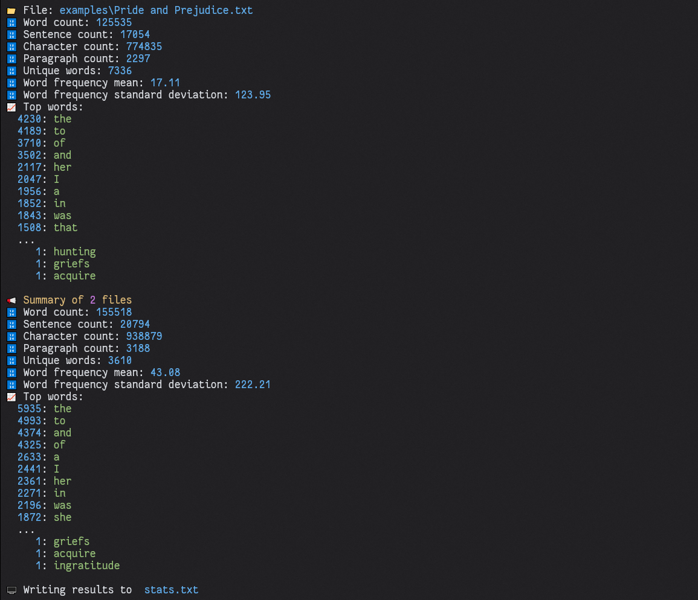
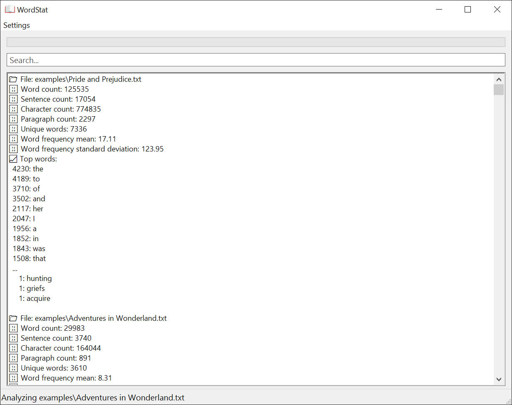

# wordstat

Simple tool to quickly count the frequency of words in a file or collection of files.

## Usage

### CLI



Running wordstat requires specifying the path to an input file or directory with files to process.

#### Example

```shell
wordstat --outfile stats.txt examples
```

#### Details

```shell
Usage: wordstat [OPTIONS] [PATH]...

Arguments:
  [PATH]...  Path to one or multiple files or directories of files to analyze

Options:
  -l, --lowercase                    Normalize casing by lowercasing each occuring word
  -t, --top-words <TOP_WORDS>        Number of top words to show per file (0 = all) [default: 10]
  -b, --bottom-words <BOTTOM_WORDS>  Number of least occuring words to show per file [default: 3]
  -e, --emojis                       Show matching emojis for words
  -s, --show-all-words               Print combined analysis with all words found in files
  -w, --word-filter <WORD_FILTER>    Filter printed words by string or regex
  -r, --recursive                    Iterate through subdirectories
  -f, --follow-symlinks              Follow symlinks
  -o, --outfile <OUTFILE>            The path to a file that the results will be written to, will
                                     overwrite if it already exists
  -h, --help                         Print help
  -V, --version                      Print version
```

`word-filter` accepts simple search terms and regular expressions. It is evaluated as regex if it starts with `/` and ends with `/` or `/i`, ending in `/i` will make the regex case-insensitive.

### GUI



#### Details

The search bar accepts simple search terms and regular expressions. It is evaluated as regex if it starts with `/` and ends with `/` or `/i`, ending in `/i` will make the regex case-insensitive.

## Download

A build of the latest version can be found on the [release page](https://github.com/Systemcluster/wordstat/releases).

Alternatively it can be installed with `cargo`:

```shell
cargo install --git https://github.com/Systemcluster/wordstat.git --bin wordstat
```

The GUI version can be installed with `cargo` as well, note that the GUI is Windows-only for now:

```shell
cargo install --git https://github.com/Systemcluster/wordstat.git --no-default-features --features gui --bin wordstat-gui
```
